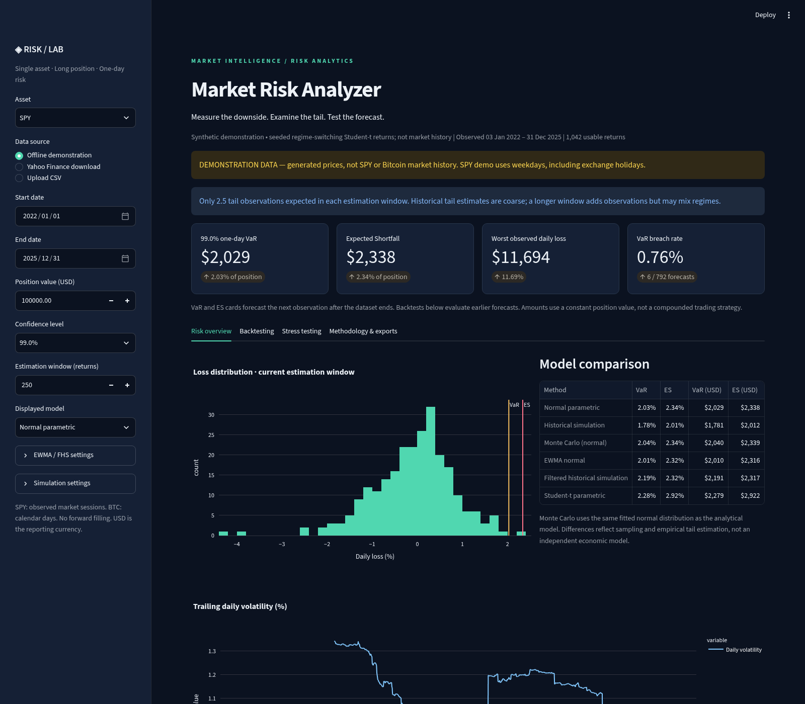

# 📊 Market Risk Analyzer — VaR, Expected Shortfall & Stress Testing

## 🚀 Introduction

Market Risk Analyzer is a Python project that measures potential losses on **SPY**, an ETF tracking the S&P 500, and **Bitcoin (BTC-USD)**. It compares six risk models and checks how their forecasts hold up against subsequent returns.

The app brings together Value at Risk (VaR), Expected Shortfall (ES), backtesting, and stress testing in a Streamlit dashboard. You can change the investment amount, confidence level, and estimation window to see how the results change.

Data can come from Yahoo Finance, a CSV upload, or the included offline demonstration. **The offline data and sample report are synthetic**, so their results should not be read as actual SPY or Bitcoin performance.

## 🎯 Objectives

- ✅ Calculate one-day VaR and Expected Shortfall using parametric and non-parametric methods.
- ✅ Compare risk estimates at 95%, 97.5%, and 99% confidence.
- ✅ Check forecasts through rolling backtests that use only past observations.
- ✅ Examine losses under historical events and custom price shocks.
- ✅ Explain model differences through charts, breach counts, and statistical tests.
- ✅ Export the results and assumptions for further analysis.

## 🏗️ Project Workflow

1. **Load data** — download adjusted prices, upload a CSV, or select the offline example.
2. **Prepare returns** — validate the prices and calculate daily simple returns without forward filling.
3. **Estimate risk** — fit the models to a trailing window of returns.
4. **Backtest forecasts** — compare each forecast with the next observed loss.
5. **Apply stress scenarios** — calculate losses for selected historical periods or a user-defined shock.
6. **Review and export** — compare models and download the results as CSV files.

SPY uses market sessions, while Bitcoin trades every day. The app keeps these calendars separate: a one-day estimate does not always cover the same elapsed time for both assets.

## 🧮 Risk Models

| Model | What it does |
|---|---|
| **Normal parametric** | Estimates VaR and ES from the window's mean and standard deviation, assuming normally distributed returns. |
| **Historical simulation** | Uses the observed loss distribution without fitting a parametric distribution. |
| **Monte Carlo (normal)** | Simulates normal returns as a numerical check of the normal parametric model. |
| **EWMA normal** | Gives more weight to recent squared return innovations when estimating volatility. Lambda defaults to 0.94. |
| **Filtered historical simulation** | Filters returns using EWMA volatility, bootstraps the standardized residuals, and rescales them for the next day. |
| **Student-t parametric** | Fits a Student-t distribution to allow heavier tails than the normal model. |

EWMA and filtered historical simulation support both sample-mean and zero-mean settings. Random draws use a configurable seed so the calculations can be repeated.

Student-t fitting uses documented bounds of **1.01 ≤ degrees of freedom ≤ 1000**. The full formulas, fitting assumptions, and empirical tail definitions are in the [methodology notes](docs/methodology.md).

## 🔍 Backtesting & Stress Testing

The backtest moves through the return series one observation at a time. Each forecast uses the previous estimation window, excluding the return it is about to predict.

The dashboard reports:

- **VaR breaches:** how often the realized loss exceeds the forecast.
- **Kupiec test:** whether the breach frequency is consistent with the selected confidence level.
- **Christoffersen tests:** whether breaches cluster and whether coverage and independence hold jointly.
- **Basel-style traffic light:** green, yellow, or red based on the last 250 forecasts at 99% confidence. This is an educational diagnostic.
- **Descriptive ES comparison:** average realized loss versus forecast ES on breach dates. It is not a formal ES backtest and has no ES p-value.

Historical scenarios cover the **Lehman week in September 2008** and the **COVID selloff in February–March 2020**. They run only when genuine prices with the required dates are available. Bitcoin history is not fabricated for 2008, and historical scenarios are disabled for synthetic data.

You can also enter a custom shock. For example, a **−20% price move on a $100,000 position produces a $20,000 loss**. Multi-day stress losses are shown separately from one-day VaR.

## 📈 Model comparison findings

The sample analysis uses synthetic SPY data from 2022–2025, a 250-return estimation window, and **792 out-of-sample forecasts**. Simulation settings are 20,000 draws and seed 42; EWMA uses lambda 0.94 and the sample mean.

| Model | Breaches at 95% | Kupiec p-value | Breaches at 99% | Kupiec p-value |
|---|---:|---:|---:|---:|
| Normal parametric | 23 | 0.0034 | 6 | 0.4738 |
| Historical simulation | 38 | 0.7929 | 6 | 0.4738 |
| Monte Carlo (normal) | 23 | 0.0034 | 6 | 0.4738 |
| EWMA normal | 32 | 0.2005 | 11 | 0.2989 |
| Filtered historical simulation | 40 | 0.9481 | 10 | 0.4754 |
| Student-t parametric | 30 | 0.1026 | 4 | 0.1217 |

At **95% confidence**, about 39.6 breaches are expected. The normal model produces only 23, so Kupiec rejects coverage at the 5% test level. In this sample, the rejection comes from **too few breaches**, rather than too many. Historical simulation produces 38, and coverage is not rejected.

At **99% confidence**, normal and historical simulation both produce six breaches. Neither rejects coverage, but the small number of tail observations makes it harder to draw strong conclusions.

These results show why it helps to compare models at more than one confidence level. They do not establish a model that will always perform best.

📄 [Read the sample risk report](reports/sample_risk_report.md) · [View the full model results](reports/sample_model_results.csv)

## 🖥️ Dashboard Preview



*The screenshot shows the offline synthetic example, not live market data.*

The app has four tabs: **Risk overview**, **Backtesting**, **Stress testing**, and **Methodology & exports**. Alongside the charts, you can download forecasts, breaches, diagnostics, stress results, and configuration files. The complete project ZIP is prepared on request and cached for later downloads.

## ⚙️ Installation & Setup

Use **Python 3.11 or newer**. No paid API is required.

**1. Clone the repository**

```bash
git clone https://github.com/InfinitySingh0/market-risk-analyzer.git
cd market-risk-analyzer
```

**2. Create a virtual environment**

```bash
python -m venv .venv
```

Activate it on Windows PowerShell:

```powershell
.venv\Scripts\Activate.ps1
```

Or on macOS/Linux:

```bash
source .venv/bin/activate
```

**3. Install dependencies and run the app**

```bash
python -m pip install -r requirements.txt
python -m streamlit run app.py
```

Open **http://localhost:8501**. The app starts in offline demonstration mode. Select **Yahoo Finance download** or **Upload CSV** to use market observations. If a download fails, the app clearly labels its switch to synthetic data.

Already cloned the project? Stop the running app with `Ctrl+C`, activate your environment, then run:

```bash
git pull
python -m pip install -r requirements.txt
python -m streamlit run app.py
```

For CSV uploads, use `Date` and `Adjusted Close` columns. You can also select a `Close` column explicitly. Prices must be positive, dates must be unique, and missing values are not filled. See the [data conventions](docs/methodology.md#data-conventions) for the format and calendar handling.

## 📦 Tools & Libraries

- **Python, pandas, NumPy** — data preparation and numerical calculations.
- **SciPy, statsmodels** — distributions, model fitting, and statistical calculations.
- **Streamlit, Plotly** — dashboard and interactive charts.
- **yfinance** — optional Yahoo Finance downloads.
- **pytest** — automated calculation, backtesting, and UI checks.

Dependency requirements are listed in [requirements.txt](requirements.txt).

## 📁 Project Structure

```text
market-risk-analyzer/
├── app.py                    # Streamlit dashboard
├── risklab/
│   ├── data.py               # Prices, validation, and returns
│   ├── risk.py               # Six VaR and ES methods
│   ├── backtest.py           # Rolling forecasts and diagnostics
│   └── stress.py             # Historical and custom scenarios
├── tests/                    # Numerical and UI tests
├── data/                     # Synthetic offline datasets
├── reports/                  # Sample report and CSV results
├── docs/                     # Methodology and screenshot
├── generate_sample.py        # Recreate the offline data
├── generate_report.py        # Recreate the 95% and 99% report
└── requirements.txt
```

## 🧪 Testing & Reproducibility

The recorded local validation passed **49 automated tests** covering calculations, confidence-level behavior, seed repeatability, look-ahead prevention, backtest edge cases, and the dashboard. These are software checks, not independent certification of the risk models.

Run the checks and regenerate the sample analysis with:

```bash
python -m pytest -q
python generate_sample.py
python generate_report.py
```

In the validated environment, regenerating the sample data and reports produced byte-identical files. Details are recorded in [VALIDATION.md](VALIDATION.md). GitHub Actions is configured to test Python 3.11 and 3.12; check the [Actions page](https://github.com/InfinitySingh0/market-risk-analyzer/actions) for the latest run.

## 📌 Limitations / not done

- The sample findings use **synthetic data**. Real-market results depend on the asset, dates, and estimation window.
- ES diagnostics are descriptive; an Acerbi–Székely Z2 test and simulated ES p-values are not implemented.
- Basel-style colors are educational, not a regulatory capital or compliance assessment.
- At 99% confidence, a 250-return window provides only **2.5 observations of tail mass**. Bootstrapping does not create new information about extreme losses.
- Student-t fitting is constrained, and normal/t distributions can imply losses above 100%. FHS uses in-window initialization and a fixed mean. These assumptions are explained in the methodology notes.
- Market-data access and calendar-gap detection have limitations. Provider data retains its own usage terms.
- The app covers a single long position. It does not model multi-asset dependence, derivatives, liquidity, transaction costs, multi-day VaR scaling, automatic model selection, or multiple-testing corrections.

## 🔧 Possible Next Steps

- Add a formal ES backtest with a documented simulation procedure.
- Extend the analysis to multi-asset portfolios and correlated shocks.
- Improve exchange-calendar validation for uploaded data.
- Compare models on a separately reserved market-data holdout period.

## ☁️ Streamlit Community Cloud

Connect this repository to Streamlit Community Cloud, choose the `main` branch, set **`app.py`** as the entry point, and select Python 3.12. The service reads `requirements.txt` and `.streamlit/config.toml` from the repository.

No API secrets are needed for the offline example or Yahoo adapter. Provider access and hosting resources can vary, and the first rolling Student-t calculation may take longer than cached runs. These instructions describe deployment; the repository does not include an already deployed Cloud URL.

## 📜 License

This project is licensed under the [MIT License](LICENSE). Third-party libraries and market data retain their own licenses and terms.
